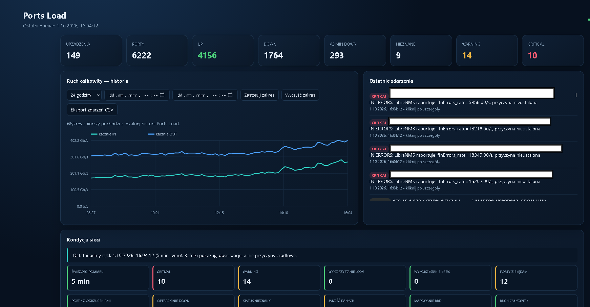

# Ports Load




Monitor portow switchy wykorzystujacy dane z LibreNMS. Zawiera alarmy, raport terminalowy,
historie SQLite oraz lokalny dashboard WWW. Nie wymaga zewnetrznych bibliotek.

Uwaga: ta instalacja LibreNMS ogranicza liczbe kolumn w pojedynczym zapytaniu API. Podstawowy
polling pobiera status, szybkosc oraz ruch IN/OUT. Bledy i discardy wymagaja dodatkowego zapytania
i nie sa obecnie uwzgledniane w alarmach.

## Uruchomienie

1. W LibreNMS utworz token: **Settings -> API Settings -> API Access**.
2. Skopiuj `config.example.json` jako `config.json` i wpisz URL oraz token.
3. `device_ids: []` monitoruje wszystko; np. `[12, 15]` ogranicza zakres.
4. Test i pelny raport: `python main.py --once`; tryb ciagly: `python main.py`.
5. Dashboard: `python dashboard.py`, potem otworz `http://127.0.0.1:8080`.

Token, stan oraz baza sa ignorowane przez Git. Domyslnie alarm powstaje po dwoch kolejnych
przekroczeniach i jest ponawiany co 30 minut.

## Raporty CLI

```powershell
python main.py --report
python main.py --report --top 50
python main.py --report --problems-only
python main.py --report --device SW-CORE-01
python main.py --report --history 7d
```

Raport pokazuje stan sieci, sumaryczny ruch, najbardziej obciazone porty, bledy, discardy oraz
ostatnie zdarzenia. W trybie ciaglym ekran jest automatycznie odswiezany po kazdym pollingu.

## Historia i retencja

`ports_history.db` przechowuje biezacy stan wszystkich portow, cykle pollera, zdarzenia oraz
probki historyczne. Domyslnie probki zapisywane sa dla portow o wykorzystaniu >= 10%, portow DOWN,
portow z bledami/discardami i aktywnymi alarmami. Zapobiega to powstawaniu milionow nieprzydatnych
rekordow. `history.all_ports: true` wlacza pelna historie wszystkich portow.

Kontrola bazy i lokalna kopia zapasowa:

```powershell
python main.py --check-db
python main.py --backup
```

Kopia trafia do katalogu `backups` (ignorowanego przez Git). Zawiera baze, `config.json` i
`state.json`, dlatego musi pozostac chroniona — konfiguracja zawiera token API. Zachowywanych jest
14 najnowszych kopii.

## Historia LibreNMS RRD przez SSH

Sekcja `rrd_ssh` pozwala dashboardowi czytac istniejace pliki RRD na serwerze LibreNMS.
Serwer nie wymaga instalowania ani modyfikowania LibreNMS. Polaczenie musi dzialac kluczem SSH
bez interaktywnego hasla. Po zmianie konfiguracji wykonaj co najmniej jeden `python main.py --once`,
aby zapisac oryginalne `port_id` uzywane w nazwach plikow RRD, a nastepnie uruchom ponownie
`python dashboard.py`. Gdy SSH lub RRD jest niedostepne, dashboard automatycznie pokazuje historie
z lokalnej bazy SQLite i wyswietla powod przelaczenia.

Domyslna retencja: probki 30 dni, zdarzenia 365 dni, podsumowania cykli 730 dni.

## Dashboard

Panel WWW zawiera karty stanu, wykres ruchu calej sieci, ranking portow, filtrowanie problemow,
historie wybranego portu, dziennik zdarzen oraz eksport CSV. Motyw jasny lub ciemny jest zapisywany
osobno w kazdej przegladarce i jest stosowany takze do raportow HTML/PDF. Lista urzadzen pokazuje
nazwe z LibreNMS (`sysName`) oraz pozwala ustawic wspolna, lokalna nazwe uzywana tylko w Ports Load.
Zmiana tej nazwy nie modyfikuje konfiguracji LibreNMS. Domyslnie dashboard nasluchuje tylko lokalnie.
Udostepnienie w LAN: `python dashboard.py --host 0.0.0.0` (przedtem zabezpiecz dostep firewallem).

## Diagnostyka multicastu

W czasie awarii porownaj wykresy `Bits`, `Errors` i `Discards` na uplinkach i portach odbiornikow.
Sprawdz logi zmian STP/LAG, CPU switcha oraz status IGMP snooping i IGMP queriera. Netflix to
unicast TCP/QUIC; moze dzialac dobrze mimo utraty multicast UDP, ktory nie retransmituje pakietow.

Polling LibreNMS moze nie pokazac mikroburstow ani IGMP flooding. Wtedy potrzebne sa liczniki
kolejek/telemetria ze switcha albo sFlow/NetFlow.
