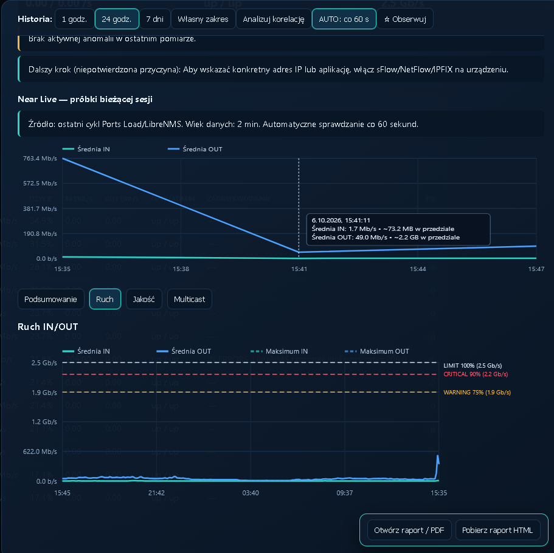

# Ports Load — showroom

Ports Load to wewnętrzny dashboard wspierający obserwację obciążenia portów
sieciowych na podstawie danych monitoringu. Łączy podgląd aktualnego stanu z
historią, aby szybciej zauważać przeciążenia i nieprawidłowości.

## Co pokazuje aplikacja

- wykorzystanie ruchu IN i OUT względem prędkości portu;
- błędy, discardy i status administracyjny/operacyjny;
- historię ruchu oraz progi ostrzegawcze i krytyczne;
- korelację zdarzeń z innymi portami;
- sekcje ruchu, jakości i multicastu;
- raport HTML/PDF oraz eksport zdarzeń.

## Bezpieczny publiczny podgląd

To repozytorium jest showroomem: zawiera wyłącznie opis, zatwierdzone zrzuty
ekranu oraz historię bezpiecznych opisów zmian. Kod źródłowy, konfiguracja,
dane monitoringu i elementy infrastruktury pozostają w prywatnym projekcie.

Każdy commit w prywatnym projekcie automatycznie tworzy commit showroomu z tym
samym opisem. Dzięki temu strona zmian pozostaje aktualna bez ręcznego,
drugiego publikowania.

Autor: Marcin Cichy
